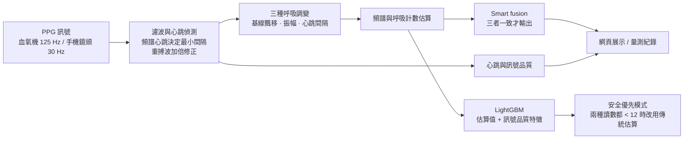
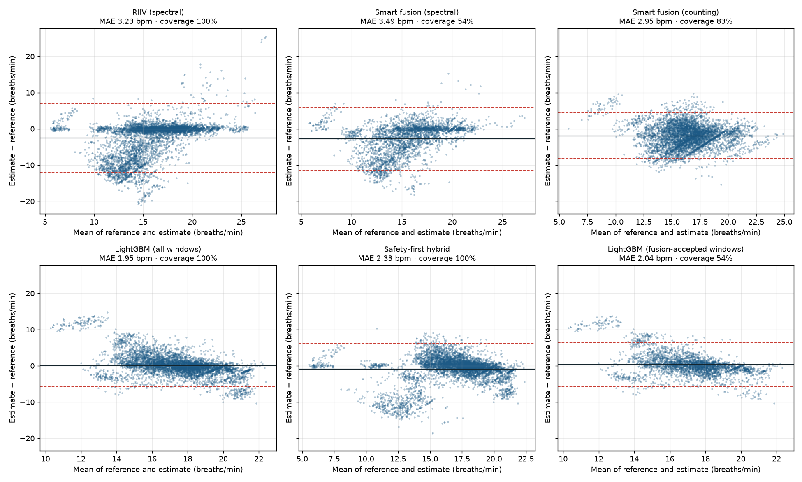
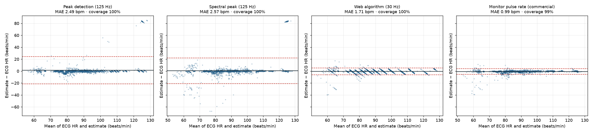

# PPG 呼吸速率估算

[](https://github.com/Joshhsu921/ppg-respiratory-rate/actions/workflows/tests.yml)

從光體積變化描記訊號(PPG,也就是血氧機與智慧手錶上的光學脈搏訊號)估算呼吸速率,比較傳統訊號處理和機器學習兩類方法,並提供一個可以用手機鏡頭即時量測的網頁展示。

**重點摘要**

- **呼吸速率:** 53 位 ICU 病人、依病人分組交叉驗證,LightGBM MAE **1.95 次/分**,最佳傳統方法 2.95。但 LightGBM 完全抓不到呼吸過慢(< 12 次/分);另提供「安全優先」混合模式,能抓到 77%,代價是整體 MAE 變成 2.33。
- **心跳:** 以心電圖為參考,實際上線的網頁演算法在 30 Hz 訊號上 MAE **1.75 次/分**(商用監視器 0.99)。
- **網頁:** 手機鏡頭即時量測、量測紀錄與情境統計、資料集重播;紀錄只存在裝置上。
- **限制:** 全部驗證都用醫療級血氧機訊號,**手機鏡頭尚未和參考設備比對**,也還沒做外部資料集驗證。



**線上展示:** <https://joshhsu921.github.io/ppg-respiratory-rate/>(手機開啟可用鏡頭量測)


QR Code 由 `python scripts/make_qr.py` 產生;網址改變時重新執行即可。

> 作品集技術展示,未經臨床驗證,不可用於診斷或病人監測。

## 為什麼做這個

呼吸速率是預警病情惡化最敏感的生命徵象之一(NEWS 等早期預警評分都包含它),但在病房裡最常被目測估算,甚至漏量。血氧機本來就有 PPG 訊號,如果能從同一個訊號估算呼吸速率,就不需要額外的感測器。

## 方法

呼吸會在 PPG 上留下三種調變(Karlen et al., 2013):

| 調變 | 生理機制 | 程式中的名稱 |
|---|---|---|
| 基線飄移 | 胸腔壓力改變靜脈回流 | `riiv` |
| 脈搏振幅變化 | 每搏輸出量隨呼吸改變 | `riav` |
| 心跳間隔變化 | 呼吸性竇性心律不整 | `rifv` |

處理流程(`src/ppgrr/dsp.py`):

1. PPG 濾波(0.5–8 Hz)後偵測每一下心跳的波峰和波谷。
2. 每下心跳取一個值,形成三條逐拍序列,重新取樣到 4 Hz。
3. 在呼吸頻帶(每分鐘 4–42 次)內用頻譜峰值和呼吸計數兩種方式估算呼吸速率。
4. **Smart fusion:** 三種估算的標準差 ≤ 4 次/分時才輸出平均值,否則判定為訊號不可靠並拒絕輸出。
5. **LightGBM:** 以上述估算值和訊號品質特徵(心跳數、心跳間隔變異、PPG 偏度與峰度、頻譜集中度)作為輸入,學習修正誤差。

## 資料

[BIDMC PPG and Respiration Dataset](https://physionet.org/content/bidmc/1.0.0/)(PhysioNet,ODC-BY 1.0):53 位 ICU 病人,每位 8 分鐘,PPG 取樣率 125 Hz。參考呼吸速率由兩位標註者在阻抗呼吸訊號上逐次標註呼吸。

- 視窗:32 秒,每 4 秒滑動一次。
- 參考值:視窗內呼吸間隔平均值換算的呼吸速率(兩位標註者取平均)。
- **依病人分組的 5 折交叉驗證:** 每位病人的預測都來自沒看過這位病人的模型,避免同一病人的視窗同時出現在訓練和測試資料中。

## 結果

### 呼吸速率

53 位病人、5,986 個視窗,依病人分組 5 折交叉驗證(`results/metrics.csv`):

| 方法 | 涵蓋率 | MAE(次/分) | 偏差 | 95% 一致性界限 | 誤差 ≤ 2 次/分 |
|---|---|---|---|---|---|
| 基線飄移(頻譜) | 100% | 3.24 | −2.53 | −12.1 ~ +7.0 | 65% |
| 脈搏振幅(頻譜) | 100% | 5.84 | −4.28 | −16.9 ~ +8.3 | 37% |
| 心跳間隔(頻譜) | 100% | 5.67 | −1.25 | −16.3 ~ +13.8 | 40% |
| Smart fusion(頻譜) | 54% | 3.49 | −2.72 | −11.4 ~ +5.9 | 49% |
| Smart fusion(呼吸計數) | 83% | 2.95 | −1.93 | −8.2 ~ +4.4 | 43% |
| **LightGBM** | 100% | **1.95** | +0.14 | −5.7 ~ +6.0 | **68%** |
| LightGBM(僅 fusion 接受的視窗) | 54% | 2.04 | +0.35 | −5.8 ~ +6.5 | 66% |
| 兩位標註者之間(上限參考) | 100% | 0.38 | +0.16 | −2.0 ~ +2.4 | 93% |



**重要發現:LightGBM 會往平均值靠攏。** 79% 的視窗呼吸速率落在每分鐘 12–20 次,模型在這個範圍表現最好,但在**呼吸過慢**時反而遠比簡單的訊號處理方法差(`results/mae_by_rr_band.csv`):

| 參考呼吸速率 | 基線飄移 MAE | LightGBM MAE | 視窗數 |
|---|---|---|---|
| < 12 次/分 | **1.34** | 8.86 | 273 |
| 12–20 次/分 | 3.03 | **1.38** | 4,723 |
| > 20 次/分 | 4.73 | **2.76** | 990 |

呼吸過慢是臨床上要抓的警訊之一,例如術後鴉片類止痛藥造成的呼吸抑制;NEWS2 預警評分中,每分鐘 ≤ 8 次就是最高的 3 分。整體平均誤差最低的模型,可能在這種時候把數字往正常範圍拉,反而延誤警示。

#### 嘗試改善呼吸過慢(`scripts/slow_breathing.py`,`results/slow_breathing.csv`)

除了 MAE,也計算每種方法**判斷「呼吸過慢」(< 12)的敏感度和特異度**,因為臨床上要的是「該警示時有警示」:

| 方法 | 整體 MAE | 過慢時 MAE | 過慢敏感度 | 過慢特異度 |
|---|---|---|---|---|
| 基線飄移(傳統) | 3.23 | 1.34 | 92% | 74% |
| LightGBM | **1.95** | 8.86 | **0%** | 99% |
| LightGBM + 依出現頻率反向加權 | 2.10 | 9.01 | 0% | 98% |
| 混合:基線飄移 < 12 就採用它 | 3.48 | 1.35 | 92% | 74% |
| **安全優先:基線飄移的頻譜法和計數法都 < 12 才採用** | 2.33 | **2.23** | **77%** | **90%** |

- **加權訓練沒有用。** 呼吸過慢的視窗只來自 11 位病人,交叉驗證時,被測試病人的過慢模式在訓練資料中幾乎沒有,模型學不起來。
- **模型對自己太有自信。** LightGBM 分位數迴歸的 80% 預測區間,實際只涵蓋 54% 的真實值,呼吸過慢時是 0%,所以「區間太寬就不輸出」的策略篩不掉錯的視窗。
- **單一方法的混合誤報太多:** 基線飄移本身平均低估 2.5 次/分,很多正常呼吸被讀成 < 12。要求兩種讀數都同意才切換,特異度從 74% 提高到 90%。
- **要用哪一種,取決於應用情境:** 一般監測可用 LightGBM(準確度優先);術後呼吸抑制監測這類情境,應選安全優先模式。
- **注意:** 安全優先的規則是在同一份資料上比較 5 種規則後選出的,結果可能偏樂觀,需要在獨立資料集上確認。
- 所有方法抓呼吸過快(> 20)的能力都不好(LightGBM 敏感度 20%,基線飄移 52%),還需要改善。

### 心跳

以 BIDMC 監視器同步記錄的**心電圖心跳**為參考值,32 秒與 10 秒視窗(`scripts/validate_hr.py`,`results/hr_metrics.csv`)。「網頁演算法」是把 PPG 降到每秒 30 個樣本(和手機鏡頭相同),再用實際上線的 `web/ppg-dsp.js` 計算(`scripts/hr_web_eval.js`)。

| 視窗 | 方法 | MAE(次/分) | 偏差 | 95% 一致性界限 | 誤差 ≤ 5 次/分 |
|---|---|---|---|---|---|
| 32 秒 | 簡單波峰偵測(Python,125 Hz) | 2.49 | +1.45 | −21.3 ~ +24.2 | 96% |
| 32 秒 | **網頁演算法(30 Hz)** | **1.75** | −0.60 | −6.9 ~ +5.7 | 96% |
| 32 秒 | 監視器內建脈搏(商用演算法,對照) | 0.99 | −0.72 | −5.5 ~ +4.1 | 97% |
| 10 秒 | **網頁演算法(30 Hz)** | 2.51 | −0.99 | −12.8 ~ +10.9 | 91% |
| 10 秒 | 監視器內建脈搏(商用演算法,對照) | 1.36 | −0.73 | −6.8 ~ +5.4 | 95% |



- 網頁演算法用頻譜心跳決定兩次心跳的最小間隔,一致性界限比簡單波峰偵測窄很多(±6 vs ±23),因為它不會把重搏切跡誤認成心跳。
- **訊號品質標示有用:** 32 秒視窗中,「良好」的 MAE 是 1.44,「不穩定」是 4.78。
- **心電心跳和脈搏不一致(41 號病人):** 誤差最大的病人。部分時段心電心跳在每分鐘 53–85 次之間跳動,網頁演算法和**監視器內建的商用演算法都是 50**。PPG 波形上每次脈搏之後的小波峰位在週期 33% 處,是重搏波而不是被漏掉的弱心跳。最可能是**脈搏短絀**:部分心跳(例如期外收縮)沒有產生可量到的脈搏。PPG 只看得到有效的脈搏,單靠 PPG 無法偵測這種情況,這是 PPG 量心跳的本質限制,也代表品質標示「良好」**無法保證數值和心電圖一致**。
- **重搏波過強時心跳加倍(已修正):** 合成訊號測試發現,重搏波很明顯時,頻譜會抓到兩倍的頻率,心跳被算成兩倍。現在會檢查被算成心跳的波峰是否一高一低或一短一長交替:間隔一短一長就判定為重搏波,改用一半的頻率重新偵測;高低交替但間隔平均(可能是真正的弱心跳)則不硬選,頁面同時顯示兩個可能的心跳並把品質降為「尚可」。這項判斷需要至少 16 下心跳,因為在 10 秒視窗上,一半以上的標示是誤報。修正後 BIDMC 整體結果不變(32 秒 MAE 1.74 → 1.75),合成情境測試見 `tests/web_dsp_cases.js`。
- 只有 10 秒的視窗誤差明顯變大,運動後心跳恢復模式若要用短視窗,需要先改善並另外驗證。
- 這是醫療級血氧機的訊號降取樣後的結果,**不等於手機鏡頭的準確度**,手機鏡頭仍需要和參考設備同時量測比對。

### 修正紀錄

- **2026-11-06:取樣率錯誤。** BIDMC CSV 的時間欄位經過四捨五入,舊版用時間差的中位數推算取樣率,得到 100 Hz(正確是 125 Hz)。參考值和估算值被同樣縮放成 0.8 倍,所以結果看似合理,實際上數字和濾波頻帶都不正確。修正後重新計算,上方都是修正後的結果;舊版「LightGBM 在呼吸過快時最差」的結論不成立,改為「呼吸過慢時最差」。已加入單元測試防止再次發生。網頁演算法直接使用時間戳,不受影響。

## 網頁展示功能

- **手機鏡頭即時量測:** 指尖蓋住鏡頭約 40 秒,顯示呼吸速率、心跳、訊號品質,以及三種調變各自的估算值。程式會自動在紅色和綠色通道中選訊號較好的一個(紅色在強光下容易過曝)。
- **量測紀錄:** 儲存每次量測,並記下情境(休息、起床後、睡前、運動後、工作、壓力、身體不適)、姿勢和備註。
  - **自己數一次:** 內建 30 秒計時器,和 App 的估算比較,累積後顯示平均差距,等於一個小型的個人驗證。
  - **趨勢圖與情境統計:** 依情境分色,並標出休息時常見範圍(每分鐘 12–20 次)。
  - **匯出 CSV**,可以拿回 Python 分析。
  - 紀錄只存在裝置的瀏覽器(localStorage),不會上傳。
- **資料集重播:** BIDMC 病人紀錄的參考值、訊號處理和 LightGBM 估算比較。

## 專案結構

```
src/ppgrr/      dsp.py(訊號處理)、data.py(資料載入)、features.py、evaluate.py
scripts/        prepare_data.py → run_experiments.py → export_demo.py;心跳驗證:hr_web_eval.js → validate_hr.py
tests/          合成訊號的單元測試(pytest);web_dsp_cases.js 測網頁演算法(node)
web/            純前端網頁:index.html、ppg-dsp.js(dsp.py 的 JavaScript 版本)、log.js(量測紀錄)
```

## 重現步驟

```bash
python -m venv .venv
.venv\Scripts\activate
pip install -e ".[dev]"
pytest
# 下載 https://physionet.org/content/bidmc/get-zip/1.0.0/ 並解壓縮到 data/raw/
python scripts/prepare_data.py
python scripts/run_experiments.py
python scripts/slow_breathing.py   # 呼吸過慢的改善實驗
python scripts/export_demo.py
node scripts/hr_web_eval.js && python scripts/validate_hr.py   # 心跳驗證
python -m http.server 8000 -d web   # 開啟 http://localhost:8000
```

## 限制

- 資料只有 53 位病人,來自單一醫院的 ICU,而且都是靜止狀態;沒有測試走動或運動時的表現。
- 參考值來自阻抗呼吸訊號的人工標註,本身也有誤差(見結果中兩位標註者之間的一致性)。
- 尚未做外部驗證。下一步可以用 CapnoBase(以二氧化碳監測為參考值)作為獨立測試集,並確認安全優先規則是否仍然有效。
- 手機鏡頭量測的訊號品質比醫療級血氧機差,網頁展示只用來說明原理。

## 參考文獻

- Karlen W, et al. Multiparameter respiratory rate estimation from the photoplethysmogram. *IEEE Trans Biomed Eng* 2013;60:1946–53.
- Pimentel MAF, et al. Toward a robust estimation of respiratory rate from pulse oximeters. *IEEE Trans Biomed Eng* 2017;64:1914–23.
- Charlton PH, et al. Breathing rate estimation from the electrocardiogram and photoplethysmogram: a review. *IEEE Rev Biomed Eng* 2018;11:2–20.
- Schäfer A, Kratky KW. Estimation of breathing rate from respiratory sinus arrhythmia. *Ann Biomed Eng* 2008;36:476–85.
- Goldberger AL, et al. PhysioBank, PhysioToolkit, and PhysioNet. *Circulation* 2000;101:e215–20.
