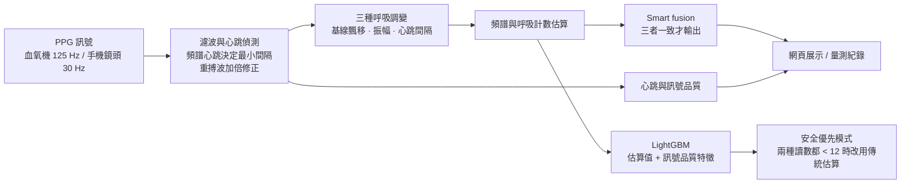
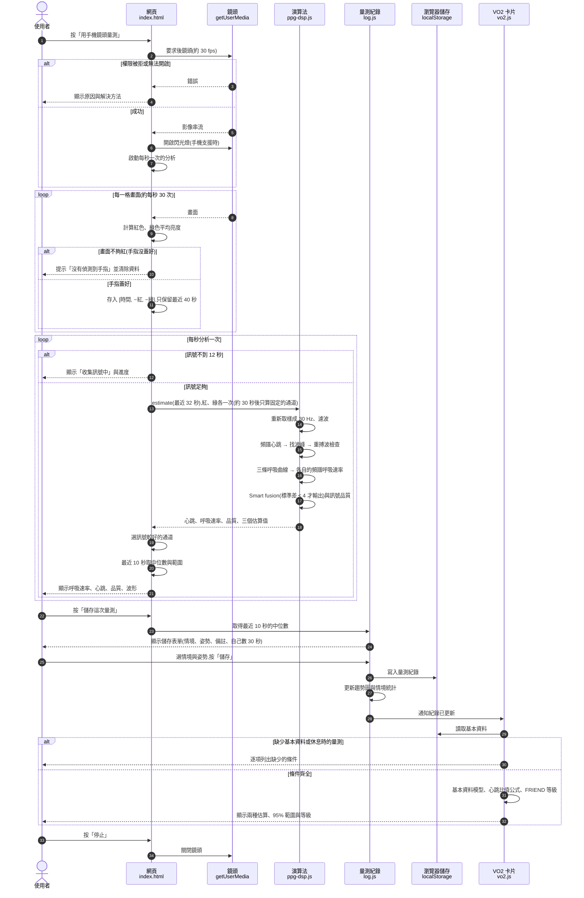
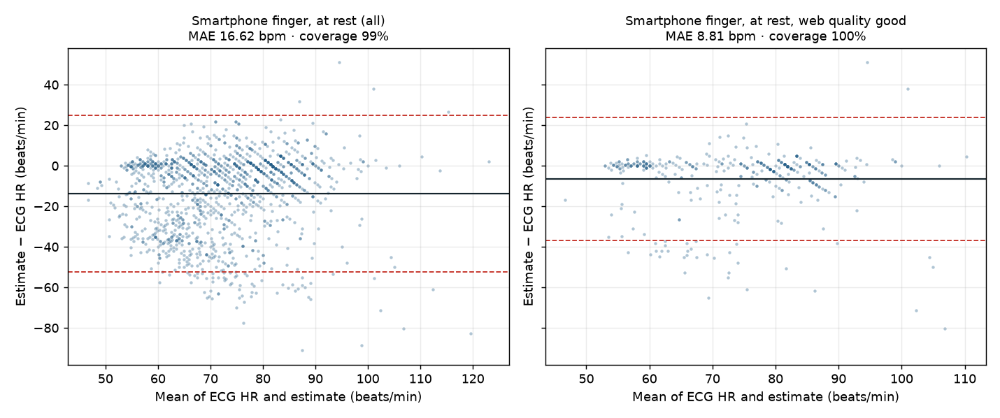

# PPG 呼吸速率與心跳估算

[](https://github.com/Joshhsu921/ppg-respiratory-rate/actions/workflows/tests.yml)

這個專案從 PPG 訊號估算**呼吸速率**和**心跳**。PPG(光體積變化描記訊號)就是血氧機和智慧手錶上的光學脈搏訊號,手機鏡頭也拍得到。專案比較了傳統訊號處理和機器學習兩類方法,並用三份公開資料集驗證準確度。另外做了一個手機網頁(原型),一般成人在家用手指蓋住鏡頭就能量測。

> 作品集技術展示,未經臨床驗證,不可用於診斷或病人監測。

**線上展示:** <https://joshhsu921.github.io/ppg-respiratory-rate/>(手機開啟可用鏡頭量測)


QR Code 由 `python scripts/make_qr.py` 產生;網址改變時重新執行即可。

## 目錄

1. [重點摘要](#重點摘要)
2. [為什麼做這個](#為什麼做這個)
3. [基礎概念:PPG 怎麼看出心跳和呼吸](#基礎概念ppg-怎麼看出心跳和呼吸)
4. [方法:網頁實際怎麼計算](#方法網頁實際怎麼計算)
5. [驗證:為什麼用三份資料](#驗證為什麼用三份資料)
6. [怎麼看結果表格裡的數字](#怎麼看結果表格裡的數字)
7. [預期用途與驗證的差距](#預期用途與驗證的差距)
8. [結果](#結果)
9. [網頁展示功能](#網頁展示功能)
10. [專案結構](#專案結構)與[重現步驟](#重現步驟)
11. [限制](#限制)
12. [參考文獻](#參考文獻)

## 重點摘要

- **呼吸速率:** 在 BIDMC(53 位 ICU 病人)上驗證。機器學習模型 LightGBM 整體平均誤差最低(MAE **1.95 次/分**),但它會把數字往常見範圍拉:**呼吸過慢(< 12 次/分)時誤差 8.86,一個都抓不到(敏感度 0%)**;傳統的基線飄移方法在呼吸過慢時誤差只有 1.34。所以網頁不用機器學習,改用不需要訓練的 smart fusion(三種估算一致才輸出)。實際上線的網頁版本在 BIDMC 上有 62% 的時段會輸出數值,平均誤差 **2.67 次/分**。
- **心跳:** 以心電圖為正確答案。網頁演算法用在血氧機訊號上誤差 **1.71 次/分**(商用監視器 0.99)。**但用在 50 位一般成人的手機錄影(BUT PPG)上,指尖靜止時誤差 13.1 次/分,只有 42% 在 ±5 次以內**;專家判定訊號良好的錄影,誤差是 3.6。手機鏡頭量心跳的準確度仍然不足。
- **VO2 max(最大攝氧量,心肺耐力指標):** 用 955 次跑步機實測驗證。只靠年齡、性別、BMI 估算,誤差約 ±12.5%,95% 範圍 ±14 mL/kg/min,對個人來說太不精確。網頁只以**實驗性卡片**呈現,並完整顯示誤差範圍。
- **網頁:** 一般成人的居家健康參考(原型),有手機鏡頭即時量測、量測紀錄、實驗性 VO2 max、資料集重播,紀錄只存在自己的裝置上。
- **最大的限制:** 呼吸速率只在 ICU 病人和醫療級血氧機上驗證過,**一般成人、手機鏡頭都還沒有呼吸速率的驗證資料**。

## 為什麼做這個

呼吸速率是預警病情惡化最敏感的生命徵象之一(NEWS 等早期預警評分都包含它),但在病房裡最常被目測估算,甚至漏量。血氧機本來就有 PPG 訊號,如果能從同一個訊號估算呼吸速率,就不需要額外的感測器。

同樣的原理也能用在手機:指尖蓋住鏡頭就能取得 PPG。對一般成人來說,長期追蹤自己安靜時的呼吸速率與心跳,可以做為健康參考,例如觀察作息、壓力或身體不適時的變化。這個專案先在臨床資料上開發與驗證演算法,再評估它搬到手機與一般成人時還能維持多少準確度。

## 基礎概念:PPG 怎麼看出心跳和呼吸

### PPG 是什麼

手指蓋住手機鏡頭時,光線穿過手指,鏡頭拍到的是透過組織的光。血液會吸收光,所以:

- 指尖的**血多** → 吸收的光多 → 畫面**暗**
- 指尖的**血少** → 吸收的光少 → 畫面**亮**

網頁把每一格畫面的紅色與綠色平均亮度記下來(鏡頭約每秒 30 格,計算前重新取樣成每秒 30 點),再把數值正負反過來,讓「血越多,數值越高」。這條隨時間變化的曲線就是 PPG。

### 怎麼看出心跳

心臟每收縮一次,就把一波血推到指尖,指尖血量短暫增加,PPG 出現一個波峰。所以**一個波峰就是一下心跳**,算出波峰之間的間隔,就能換算心跳:

```
PPG     ╱╲      ╱╲      ╱╲      ╱╲
       ╱  ╲╱╲  ╱  ╲╱╲  ╱  ╲╱╲  ╱  ╲
      ╱      ╲╱      ╲╱      ╲╱
      ↑       ↑       ↑       ↑
     心跳    心跳    心跳    心跳     間隔 0.8 秒 → 每分鐘 75 下
```

每個大波峰後面常有一個小波峰,叫做**重搏波**(主動脈瓣關閉時產生的反彈)。它不是心跳,如果被算進去,心跳就會變成兩倍。網頁有專門的步驟避免這個錯誤(見「方法」)。

### 怎麼看出呼吸

呼吸沒有直接出現在 PPG 上,但會讓脈搏波形產生三種**跟著呼吸一起一伏**的規律變化(Karlen et al., 2013):

| 變化 | 看的是什麼 | 為什麼會跟著呼吸變 | 程式中的名稱 |
|---|---|---|---|
| **基線飄移** | 整條訊號慢慢上下移動 | 吸氣時胸腔變成負壓,靜脈血較容易流回心臟,指尖的血量跟著變少;吐氣時又變多 | `riiv` |
| **脈搏振幅變化** | 每一下脈搏的大小 | 每次心跳打出去的血量,會隨胸腔壓力改變 | `riav` |
| **心跳間隔變化** | 兩下心跳之間隔多久 | 吸氣時心跳稍快、吐氣時稍慢(呼吸性竇性心律不整,健康的人都有) | `rifv` |

以**基線飄移**為例。心跳的小波浪是「騎」在呼吸的大起伏上面的:

```
        ╱╲  ╱╲                    ╱╲  ╱╲
   ╱╲  ╱  ╲╱  ╲╱╲              ╱╲╱  ╲╱  ╲
  ╱  ╲╱          ╲╱╲      ╱╲  ╱          ╲╱
                    ╲╱╲  ╱  ╲╱
                       ╲╱
  |←─────── 一次呼吸(約 4 秒)───────→|
```

在每一下心跳的波峰位置讀出訊號的高度,把這些點連起來,就得到一條隨呼吸起伏的曲線:

```
每下心跳的波峰高度:
  ●     ●                       ●
     ●     ●                 ●     ●
              ●           ●
                 ●     ●
                    ●
  → 這條曲線的週期就是呼吸的週期
```

另外兩種也一樣,只是每下心跳取的值不同:

| 名稱 | 每下心跳取什麼值 |
|---|---|
| 基線(riiv) | 波峰當下的訊號高度 |
| 振幅(riav) | 波峰減波谷,也就是這下脈搏有多大 |
| 間隔(rifv) | 和上一下心跳隔了多久 |

三條曲線各自找出週期,例如週期是 4 秒,呼吸速率就是每分鐘 60 ÷ 4 = 15 次。

### 用的是固定公式,還是訓練出來的模型?

**網頁用的是固定的訊號處理演算法,不是訓練出來的模型。** 它也不是一條公式,而是好幾個步驟串起來,每一步都根據上面的生理現象。

演算法裡的數字(濾波範圍、最小心跳間隔、三種估算要多一致才輸出)是人工設定的參數,來源有三種:

- **生理範圍:** 例如成人的呼吸大約每分鐘 4–42 次、心跳 40–180 下。
- **參考文獻的做法:** 例如三種調變和 smart fusion 的概念。
- **用資料比較後選定:** 例如手機心跳用的 0.7 Hz 高通,是在 BUT PPG 開發組上比較 24 種設定後選的(見「改進手機心跳」)。

專案裡**另外有**一個機器學習模型 LightGBM,用來比較,但網頁沒有使用它,原因見「方法」的最後一段。

## 方法:網頁實際怎麼計算

以下是實際上線的 `web/ppg-dsp.js` 的步驟,每秒用最近 32 秒的訊號重新計算一次。



(圖中 LightGBM 和安全優先模式只在 Python 版的實驗中使用,網頁走的是 B → C → D → E 與 H。)

### 時序圖:一次量測從開始到儲存

下圖是使用者用手機量一次、再存成紀錄時,網頁各部分之間的呼叫順序(UML Sequence Diagram)。



### 第 1 步:取得訊號

指尖蓋住後鏡頭(瀏覽器支援時會自動開閃光燈,讓光穿過手指;iPhone 的網頁不能開閃光燈,要在明亮處量)。每格畫面算紅色和綠色的平均亮度,再正負反轉。紅色在強光下容易過曝,所以兩個顏色都算,量滿約 30 秒後選訊號較好的一個,之後就固定使用(每次重新量測時重選)。

### 第 2 步:濾波

**濾波**就是只留下某個頻率範圍的變化,把其他的去掉。同一段訊號會做出兩個版本:

| 版本 | 保留的範圍 | 用途 |
|---|---|---|
| `band` | 0.5–3 Hz(約每分鐘 30–180 下) | 去掉慢的呼吸起伏和快的雜訊,只剩規律的心跳波,**用來找心跳** |
| `low` | 4 Hz 以下 | 只去掉快的雜訊,**保留呼吸造成的慢起伏**,用來讀基線和振幅 |

### 第 3 步:找心跳

1. **先估一個大概的心跳:** 做頻譜分析(把訊號拆成不同頻率,看哪個頻率最強),在每分鐘 40–180 下之間找最強的頻率。這一步用的是 0.7–3 Hz 的版本(比 `band` 多濾掉一點慢變化),避開手機自動曝光造成的慢飄移;之後找心跳仍用 `band`。
2. **決定兩下心跳最少要隔多久:** 設為大概心跳週期的 0.6 倍(但不短於每分鐘 180 下的間隔)。例如大概心跳是每分鐘 75 下(週期 0.8 秒),兩個波峰至少要隔 0.48 秒。重搏波離主波峰太近,就不會被當成心跳。
3. **找波峰:** 從最高的波峰開始挑,太靠近已選波峰的就跳過。每兩個波峰之間的最低點是波谷。
4. **檢查心跳是否被算成兩倍:** 如果被算成心跳的波峰一高一低、間隔一短一長交替出現,代表其中一半其實是重搏波,改用一半的頻率重新找。如果只是高低交替、間隔平均(可能是真的有弱心跳),不硬選,頁面同時顯示兩個可能的心跳。這項檢查需要至少 16 下心跳才做。
5. **心跳 = 60 ÷ 心跳間隔的中位數。** 用中位數是為了不被少數錯誤的間隔影響。心跳太少(32 秒內不到 7 下)時不輸出。

### 第 4 步:做出三條呼吸曲線

在第 3 步找到的每個心跳位置:

- 讀 `low` 在波峰的值 → **基線**
- 讀 `low` 在波峰減波谷的值 → **振幅**
- 算和上一下心跳的時間差 → **間隔**(和中位數差超過 30% 的間隔視為錯誤,先剔除)

這些點跟著心跳出現,時間不均勻,所以重新取樣成每秒 4 個點的平滑曲線。

### 第 5 步:估算呼吸速率

每條曲線先去除整體趨勢,再濾到呼吸範圍(每分鐘 4–42 次),然後做頻譜分析,找最強的頻率,得到三個呼吸速率估算值。

### 第 6 步:Smart fusion(三者一致才輸出)

三個估算值的標準差 ≤ 4 次/分(也就是彼此差不多)時,輸出平均值;差太多就判定訊號不可靠,**不顯示數值**。寧可不顯示,也不顯示錯的數字。這也是「涵蓋率」不是 100% 的原因。

### 第 7 步:訊號品質與顯示

依心跳間隔的穩定度給出訊號品質:

- **良好:** 心跳間隔很穩定,錯誤間隔很少,而且頻譜心跳和逐拍心跳一致
- **尚可:** 心跳間隔有些不穩定
- **不穩定:** 心跳間隔變化很大或錯誤很多

單次估算會因為一次呼吸移進或移出 32 秒的範圍而跳動 1–2 次,所以畫面顯示的是**最近 10 秒估算值的中位數**與變動範圍(例如「15.0 (13–17)」),心跳也一樣取中位數,儲存的就是這兩個數值。

### Python 版和網頁版的差別

Python 版(`src/ppgrr/dsp.py`)用在血氧機資料(125 Hz)的研究實驗上,原理相同,但:

- 心跳用 0.5–8 Hz 濾波,`low` 用 8 Hz 以下;沒有頻譜心跳決定最小間隔、重搏波修正這些針對手機的步驟。
- 呼吸速率除了頻譜法,還有**呼吸計數法**(直接數曲線有幾次起伏)。
- 有 LightGBM 機器學習模型。

### 機器學習模型 LightGBM,以及網頁為什麼不用它

LightGBM 是一種常用的機器學習模型。這裡把上面各方法的估算值,加上訊號品質特徵(心跳數、心跳間隔變異、PPG 波形的偏度與峰度、頻譜集中度)當作輸入,讓模型從 BIDMC 的資料中**學習怎麼修正誤差**。它在 BIDMC 上的整體誤差最低,但網頁沒有使用,因為:

1. **呼吸過慢時會出錯:** 訓練資料中大部分人的呼吸是每分鐘 12–20 次,模型學會把數字往這個範圍拉。呼吸過慢時,它一次都沒有判斷出來(見「結果」)。
2. **只在 ICU 病人身上學過:** 換到一般成人、換到手機鏡頭,學到的規則不一定適用。不需要訓練的方法比較沒有這個問題。

## 驗證:為什麼用三份資料

### 驗證是什麼意思

要知道一個數值準不準,資料裡要同時有:

1. **輸入:** PPG 訊號
2. **正確答案(參考值):** 用更可靠的儀器同時量到的真實數值

把演算法的輸出和正確答案比較,看差多少,就是驗證。

### 為什麼不是一份資料就好

網頁顯示三種數值,每種需要的正確答案不一樣,**沒有一份公開資料三種都有**,所以每種數值各找一份能驗證它的資料:

| 要驗證的數值 | 需要的正確答案 | 用的資料庫 |
|---|---|---|
| **呼吸速率** | 真實呼吸次數(胸部阻抗訊號,人工逐次標註) | BIDMC |
| **心跳(血氧機)** | 心電圖心跳 | BIDMC(同一份資料剛好也有心電圖) |
| **心跳(手機鏡頭)** | 心電圖心跳,而且 PPG 要是**手機錄的** | BUT PPG |
| **VO2 max** | 跑步機實測的最大攝氧量 | Treadmill(Malaga) |

FRIEND 不是驗證用的資料,而是已經發表的常模表,網頁拿它把 VO2 max 換成「偏低、良好、優秀」等級。

每份資料都只符合一部分條件:BIDMC 有呼吸的正確答案,但受試者是 ICU 病人、設備是血氧機;BUT PPG 是一般成人和手機,但沒有呼吸參考訊號;Malaga 有 VO2 max 實測值,但受試者是運動員。所以**「一般成人 + 手機 + 呼吸速率」這個組合目前沒有任何驗證**(見「預期用途與驗證的差距」)。

### 資料集

| 資料集 | 內容 | 用途 | 授權 |
|---|---|---|---|
| [BIDMC](https://physionet.org/content/bidmc/1.0.0/) | 53 位 ICU 病人,各 8 分鐘,血氧機 PPG 125 Hz;兩位標註者在阻抗呼吸訊號上逐次標註呼吸;同步心電圖心跳 | 呼吸速率開發與內部驗證、心跳驗證 | ODC-BY 1.0 |
| [BUT PPG](https://physionet.org/content/butppg/2.0.0/) | 50 位一般成人,手機指尖或耳朵 10 秒錄影,30 Hz;心電圖心跳 | 手機鏡頭心跳驗證 | CC BY 4.0 |
| [Treadmill(Malaga)](https://physionet.org/content/treadmill-exercise-cardioresp/1.0.1/) | 824 位運動員、955 次跑步機最大運動測試 | VO2 max 估算 | PhysioNet Contributor Review Health Data License 1.5.0 |

原始資料都放在 `data/raw/`,不上傳到 GitHub。

### 避免「考古題」:依人分組

如果同一個人的資料同時拿來調整方法和測試,結果會偏好,就像用考古題考試。所以專案用兩種方式把「調整用」和「測試用」的人分開:

- **依病人分組的 5 折交叉驗證(BIDMC、Malaga):** 把病人分成 5 組,每次用 4 組訓練、1 組測試,輪流 5 次。每位病人的結果都來自**沒看過這位病人**的模型。
- **開發組 / 測試組(BUT PPG):** 固定分成開發組 25 人、測試組 25 人。只在開發組上找問題和比較設定,測試組最後只評估一次。

BIDMC 的計算設定:每 32 秒為一段(視窗),每 4 秒往後滑動一次;參考值是這段時間內的呼吸間隔平均換算的呼吸速率(兩位標註者取平均)。

## 怎麼看結果表格裡的數字

| 名詞 | 意思 | 例子 |
|---|---|---|
| **MAE**(平均絕對誤差) | 估算值和正確答案平均差多少,不管高估或低估。**越小越好** | MAE 2 = 平均差 2 次/分 |
| **偏差** | 平均是高估(+)還是低估(−) | −2.5 = 平均少算 2.5 次 |
| **95% 一致性界限** | 95% 的誤差落在這個範圍內,代表**最壞的情況**大概多差。範圍越窄越好 | −8 ~ +4 = 大部分時候少算 8 次到多算 4 次之間 |
| **誤差 ≤ 2 次/分、≤ 5 次/分** | 有多少比例的估算夠接近 | 68% = 每 10 次有約 7 次差在 2 次以內 |
| **涵蓋率** | 有輸出數值的比例。smart fusion 遇到不可靠的訊號會拒絕輸出,所以不是 100% | 62% = 約六成的時段有數值 |
| **敏感度** | 真的呼吸過慢時,有多少比例被抓到。**該警示時有沒有警示** | 0% = 一次都沒抓到 |
| **特異度** | 真的正常時,有多少比例被正確判為正常。**會不會亂警示** | 74% = 每 4 個正常的人約有 1 個被誤判 |
| **兩位標註者之間** | 兩位人工標註的正確答案彼此差多少,代表「正確答案本身」的誤差,是任何方法能達到的上限參考 | MAE 0.38 |
| **Bland-Altman 圖** | 橫軸是平均值,縱軸是誤差,每個點是一段量測。點越集中在 0 附近越好,三條橫線是偏差和 95% 一致性界限 | |

## 預期用途與驗證的差距

| 項目 | 範圍 |
|---|---|
| **目標族群** | 18 歲以上一般成人 |
| **使用情境** | 在家、安靜不動時,用手機鏡頭量測呼吸速率與心跳,做為個人健康參考與長期追蹤 |
| **定位** | 作品集原型,不是醫療器材,不可用於診斷、監測或治療決策 |
| **不適用** | 兒童、心律不整(例如心房顫動、頻繁的期外收縮)、運動中或運動後立即量測、末梢循環不良 |

### 驗證證據和目標族群的差距

各項數值是在不同族群、不同設備上驗證的,沒有一項完全等於「在家用手機的一般成人」:

| 數值 | 驗證族群與設備 | 結果 | 和目標的差距 |
|---|---|---|---|
| 呼吸速率 | ICU 病人(BIDMC);醫療級血氧機 | 網頁版 MAE 2.67,涵蓋率 62%(內部驗證) | **族群與設備都不同**,沒有一般成人或手機的驗證 |
| 心跳(血氧機) | ICU 病人;醫療級血氧機 | MAE 1.71 | 族群不同 |
| 心跳(手機鏡頭) | **一般成人 50 位;手機指尖錄影(BUT PPG)** | 指尖靜止 MAE 13.1,42% 在 ±5 以內 | **族群與設備相符,但準確度不足** |
| VO2 max | 業餘與職業運動員;跑步機實測 | 95% 界限 ±14 mL/kg/min | 族群不同(運動員),且沒有真正的靜止心跳 |
| 體能等級 | FRIEND 美國一般成人 | 正式發表的常模 | 估算值本身誤差大 |

網頁頁首會連結到這張表。

### 補齊差距所需的驗證

1. **手機鏡頭心跳:** 已依受試者分組改進一次(測試組 MAE 15.8 → 12.5),仍不足。下一步是用 32 秒的錄影驗證,和網頁實際的視窗長度一致,並改善訊號品質判斷,讓網頁能可靠地拒絕不良訊號。
2. **一般成人的呼吸速率:** 需要健康成人、自然呼吸、同時有手機 PPG 與參考呼吸訊號(例如胸帶或二氧化碳監測)的資料。目前沒有找到合適的公開資料,需要自行收案,建議至少 30 人,涵蓋不同膚色、年齡與性別,並在安靜時量測。
3. **VO2 max:** 需要一般成人(不是只有運動員)同時有真正的靜止心跳與實測 VO2 max 的資料。

### 為什麼限定成人

- **驗證資料都是成人:** BIDMC 的 53 位病人、BUT PPG 的 50 位受試者(19–76 歲)都是成人,沒有兒童的驗證資料。
- **演算法有成人的假設:** 只搜尋每分鐘 4–42 次的呼吸(嬰幼兒正常可達 30–60 次)、心跳上限每分鐘 180 下。
- **VO2 max 常模(FRIEND)只涵蓋 20–79 歲**,估算模型的訓練資料也以成人運動員為主。

**限定成人不代表成人已經驗證完成**,見上方的差距表。網頁頁首會顯示適用範圍;基本資料的年齡低於 18 歲時,不計算 VO2 max。

## 結果

### 呼吸速率

53 位病人、5,986 段,依病人分組 5 折交叉驗證(`results/metrics.csv`):

| 方法 | 涵蓋率 | MAE(次/分) | 偏差 | 95% 一致性界限 | 誤差 ≤ 2 次/分 |
|---|---|---|---|---|---|
| 基線飄移(頻譜) | 100% | 3.24 | −2.53 | −12.1 ~ +7.0 | 65% |
| 脈搏振幅(頻譜) | 100% | 5.84 | −4.28 | −16.9 ~ +8.3 | 37% |
| 心跳間隔(頻譜) | 100% | 5.67 | −1.25 | −16.3 ~ +13.8 | 40% |
| Smart fusion(頻譜) | 54% | 3.49 | −2.72 | −11.4 ~ +5.9 | 49% |
| Smart fusion(呼吸計數) | 83% | 2.95 | −1.93 | −8.2 ~ +4.4 | 43% |
| **LightGBM** | 100% | **1.95** | +0.14 | −5.7 ~ +6.0 | **68%** |
| LightGBM(僅 fusion 接受的時段) | 54% | 2.04 | +0.35 | −5.8 ~ +6.5 | 66% |
| 兩位標註者之間(上限參考) | 100% | 0.38 | +0.16 | −2.0 ~ +2.4 | 93% |

**怎麼讀:** 三種調變單獨使用時,基線飄移最準,但平均少算 2.5 次。LightGBM 整體最準、幾乎沒有偏差。兩位人工標註者之間只差 0.38,代表所有方法離「完美」都還有距離。


**網頁版(JavaScript,30 Hz):** 在 BIDMC 的 32 秒時段上,smart fusion 有輸出的時段佔 62%,MAE 2.67,偏差 −1.71,95% 一致性界限 −8.6 ~ +5.2(`scripts/hr_web_eval.js` 一併輸出)。比 Python 版的 smart fusion(頻譜)略好,但不能直接比較,因為取樣率與濾波都不同。

**重要發現:LightGBM 會往平均值靠攏。** 79% 的時段呼吸速率落在每分鐘 12–20 次,模型在這個範圍表現最好,但在**呼吸過慢**時反而遠比簡單的訊號處理方法差(`results/mae_by_rr_band.csv`):

| 參考呼吸速率 | 基線飄移 MAE | LightGBM MAE | 時段數 |
|---|---|---|---|
| < 12 次/分 | **1.34** | 8.86 | 273 |
| 12–20 次/分 | 3.03 | **1.38** | 4,723 |
| > 20 次/分 | 4.73 | **2.76** | 990 |

呼吸過慢是臨床上要抓的警訊之一,例如術後鴉片類止痛藥造成的呼吸抑制;NEWS2 預警評分中,每分鐘 ≤ 8 次就是最高的 3 分。整體平均誤差最低的模型,可能在這種時候把數字往正常範圍拉,反而延誤警示。

#### 嘗試改善呼吸過慢(`scripts/slow_breathing.py`,`results/slow_breathing.csv`)

除了 MAE,也計算每種方法**判斷「呼吸過慢」(< 12)的敏感度和特異度**,因為臨床上要的是「該警示時有警示」:

| 方法 | 整體 MAE | 過慢時 MAE | 過慢敏感度 | 過慢特異度 |
|---|---|---|---|---|
| 基線飄移(傳統) | 3.23 | 1.34 | 92% | 74% |
| LightGBM | **1.95** | 8.86 | **0%** | 99% |
| LightGBM + 依出現頻率反向加權 | 2.10 | 9.01 | 0% | 98% |
| 混合:基線飄移 < 12 就採用它 | 3.48 | 1.35 | 92% | 74% |
| **安全優先:基線飄移的頻譜法和計數法都 < 12 才採用** | 2.33 | **2.23** | **77%** | **90%** |

- **加權訓練沒有用。** 呼吸過慢的時段只來自 11 位病人,交叉驗證時,被測試病人的過慢模式在訓練資料中幾乎沒有,模型學不起來。
- **模型對自己太有自信。** LightGBM 分位數迴歸的 80% 預測區間,實際只涵蓋 54% 的真實值,呼吸過慢時是 0%,所以「區間太寬就不輸出」的策略篩不掉錯的時段。
- **單一方法的混合誤報太多:** 基線飄移本身平均低估 2.5 次/分,很多正常呼吸被讀成 < 12。要求兩種讀數都同意才切換,特異度從 74% 提高到 90%。
- **要用哪一種,取決於應用情境:** 一般監測可用 LightGBM(準確度優先);術後呼吸抑制監測這類情境,應選安全優先模式。
- **注意:** 安全優先的規則是在同一份資料上比較 5 種規則後選出的,結果可能偏樂觀。
- 所有方法抓呼吸過快(> 20)的能力都不好(LightGBM 敏感度 20%,基線飄移 52%),還需要改善。

### 心跳(血氧機訊號)

以 BIDMC 監視器同步記錄的**心電圖心跳**為正確答案,32 秒與 10 秒時段(`scripts/validate_hr.py`,`results/hr_metrics.csv`)。「網頁演算法」是把 PPG 降到每秒 30 個樣本(和手機鏡頭相同),再用實際上線的 `web/ppg-dsp.js` 計算(`scripts/hr_web_eval.js`)。

| 時段長度 | 方法 | MAE(次/分) | 偏差 | 95% 一致性界限 | 誤差 ≤ 5 次/分 |
|---|---|---|---|---|---|
| 32 秒 | 簡單波峰偵測(Python,125 Hz) | 2.49 | +1.45 | −21.3 ~ +24.2 | 96% |
| 32 秒 | **網頁演算法(30 Hz)** | **1.71** | −0.54 | −6.3 ~ +5.2 | 96% |
| 32 秒 | 監視器內建脈搏(商用演算法,對照) | 0.99 | −0.72 | −5.5 ~ +4.1 | 97% |
| 10 秒 | **網頁演算法(30 Hz)** | 2.31 | −0.73 | −10.6 ~ +9.2 | 92% |
| 10 秒 | 監視器內建脈搏(商用演算法,對照) | 1.36 | −0.73 | −6.8 ~ +5.4 | 95% |


- 網頁演算法用頻譜心跳決定兩次心跳的最小間隔,一致性界限比簡單波峰偵測窄很多(±6 vs ±23),因為它不會把重搏波誤認成心跳。
- **訊號品質標示有用:** 32 秒時段中,「良好」的 MAE 是 1.44,「尚可」是 3.44,「不穩定」是 3.74。
- **心電心跳和脈搏不一致(41 號病人):** 誤差最大的病人。部分時段心電心跳在每分鐘 53–85 次之間跳動,網頁演算法和**監視器內建的商用演算法都是 50**。PPG 波形上每次脈搏之後的小波峰位在週期 33% 處,是重搏波而不是被漏掉的弱心跳。最可能是**脈搏短絀**:部分心跳(例如期外收縮)沒有產生可量到的脈搏。PPG 只看得到有效的脈搏,單靠 PPG 無法偵測這種情況,這是 PPG 量心跳的本質限制,也代表品質標示「良好」**無法保證數值和心電圖一致**。
- **重搏波過強時心跳加倍(已修正):** 合成訊號測試發現,重搏波很明顯時,頻譜會抓到兩倍的頻率,心跳被算成兩倍。現在會檢查被算成心跳的波峰是否一高一低或一短一長交替(見「方法」第 3 步)。這項判斷需要至少 16 下心跳,因為在 10 秒時段上,一半以上的標示是誤報。加入這項修正時,BIDMC 的整體結果幾乎沒變(當時 32 秒 MAE 1.74 → 1.75);上表是之後再改進手機心跳的最新結果。合成情境測試見 `tests/web_dsp_cases.js`。
- 10 秒時段的誤差明顯比 32 秒大,所以網頁用 32 秒;若之後要做需要短時段的功能(例如追蹤運動後心跳的下降),需要先改善並另外驗證。
- 這是醫療級血氧機的訊號降取樣後的結果,**不等於手機鏡頭的準確度**,手機鏡頭的結果見下一節。

### 心跳:手機鏡頭(BUT PPG)

[BUT PPG](https://physionet.org/content/butppg/2.0.0/)(Brno University of Technology,PhysioNet,CC BY 4.0):50 位成人(19–76 歲,男女各半)用兩款手機錄製的 3,888 段 10 秒 PPG,30 Hz,同步記錄心電圖。指尖貼後鏡頭或耳朵貼前鏡頭,並有靜止、加壓、滑動、走路、咳嗽、笑、改變光線、說話等情境。正確答案是心電圖 10 秒內的中位數;每段另有專家品質標註:3 或 5 位專家只看 PPG 估心跳,多數人誤差 ≤ 5 次/分才算「良好」。

把**實際上線的網頁演算法**原封不動地跑在這些錄影上,和網頁一樣在紅色與綠色中選訊號較好的一個(`scripts/butppg_export.py` → `scripts/butppg_eval.js` → `scripts/validate_butppg.py`,`results/butppg_metrics.csv`)。結果(改進後的演算法,見下方「改進手機心跳」):

| 情境 | 紀錄 / 受試者 | MAE | 偏差 | 95% 一致性界限 | 誤差 ≤ 5 次/分 |
|---|---|---|---|---|---|
| **指尖、靜止(網頁的使用方式)** | 1,354 / 30 | **13.1** | −9.4 | −44.0 ~ +25.1 | **42%** |
| 指尖、靜止、專家判定良好 | 477 / 30 | 3.6 | −1.5 | −14.8 ~ +11.8 | 82% |
| 指尖、靜止、專家判定不佳 | 877 / 20 | 18.3 | −13.7 | −53.0 ~ +25.6 | 20% |
| 指尖、靜止、網頁判定品質「良好」 | 366 / 30 | 6.4 | −3.9 | −27.8 ~ +20.1 | 70% |
| 耳朵、靜止 | 1,370 / 20 | 14.4 | −7.9 | −43.0 ~ +27.2 | 約 30% |
| 指尖、走路 / 咳嗽 / 笑 | 各 70 / 18 | 19.4–22.2 | −16.8 ~ −20.4 | — | 約 30% |

**怎麼讀:** 最重要的是第一列,也就是網頁實際的使用方式:平均差 13 下,而且偏向少算。訊號好的時候(第二列)誤差小很多,所以問題主要在訊號品質。



- **手機鏡頭量心跳的準確度仍然不足。** 指尖靜止時只有 42% 在 ±5 次以內,而且仍偏向低估,代表會漏算心跳。
- **主要原因是訊號品質:** 專家只判定 35% 的指尖靜止錄影「看得出準確的心跳」。訊號良好時,MAE 是 3.6,82% 在 ±5 次以內。
- **時段太短也是原因之一:** 每段只有 10 秒,網頁實際用 32 秒;在 BIDMC 上,10 秒的誤差本來就比 32 秒大。
- **網頁的品質判斷只有部分有效:** 判為「良好」的紀錄中,68% 是專家判定的好訊號;專家判定的好訊號,只有 52% 被網頁判為「良好」(`results/butppg_quality_crosstab.csv`)。
- **訊號方向不是問題:** 這份資料有兩種儲存格式,方向相反。方向是用波形特徵(血量波形上升快、下降慢)判斷的,不是用準確度挑選;把方向反過來重跑,結果幾乎一樣。

#### 改進手機心跳(開發組 / 測試組)

先依受試者固定分成**開發組 25 人、測試組 25 人**(`scripts/butppg_split.py`,固定亂數種子),只在開發組上找問題和比較設定,測試組最後只評估一次。

- **找到的問題:** 開發組的錯誤以「漏算」為主,其中約五分之一的錄影,心跳只算到真實值的一半。原因是 10 秒的手機錄影中,自動曝光造成的慢飄移讓頻譜心跳抓到一半的速度,用它設定的「兩次心跳最小距離」就太大,每隔一下漏掉一下。
- **比較的設定**(`scripts/web_dsp_grid.js`):高通頻率、最小距離比例、次諧波檢查等 24 種組合,並**同時要求 `tests/web_dsp_cases.js` 的合成測試全部通過**。
- **取捨:** 開發組上最好的組合 MAE 可到 10.2,但會讓 10 項合成測試失敗:重搏波被算成兩倍,慢心跳(每分鐘 45 下)也估錯。選擇不破壞既有保護、效果最好的設定:**只在估算頻譜心跳時改用 0.7 Hz 高通**,偵測心跳仍用 0.5 Hz。

| | 改進前 MAE | 改進後 MAE | 改進後誤差 ≤ 5 |
|---|---|---|---|
| 開發組(14 人有指尖靜止錄影) | 18.2 | 14.3 | 34% |
| **測試組(16 人,未參與調整)** | **15.8** | **12.5** | **47%**(改進前 43%) |
| BIDMC 血氧機訊號,32 秒 | 1.75 | 1.71 | 96% |
| BIDMC 血氧機訊號,10 秒 | 2.51 | 2.31 | 92% |

測試組的進步幅度和開發組相近,代表改進不是只貼合開發組;BIDMC 上的心跳也小幅變好,網頁的呼吸速率結果不變(MAE 2.67)。

### VO2 max:驗證結果與實驗性卡片

VO2 max 是身體每分鐘每公斤體重最多能用掉多少氧氣,是心肺耐力的指標,通常要在跑步機上戴面罩跑到力竭才量得到。想法是用年齡、性別、身高體重,加上手機量到的靜止心跳來估算。

用 [Treadmill Maximal Exercise Tests(University of Malaga,PhysioNet)](https://physionet.org/content/treadmill-exercise-cardioresp/1.0.1/) 的實測值驗證:955 次測試、824 人(多為業餘與職業運動員,女性 15%),實測 VO2 max 為 47.0 ± 8.8 mL/kg/min。依「人」分組交叉驗證(`scripts/vo2max.py`,`results/vo2max_metrics.csv`)。

| 方法 | MAE(mL/kg/min) | 誤差百分比 | 95% 一致性界限 | 相關係數 |
|---|---|---|---|---|
| Uth 公式:15.3 × (208 − 0.7 × 年齡) ÷ 開始時心跳 | 14.8 | 30% | −35.9 ~ +10.2 | 0.09 |
| 線性迴歸:年齡、性別、BMI | **5.6** | **12.5%** | −14.1 ~ +14.1 | 0.58 |
| 線性迴歸:再加開始時心跳 | 5.6 | 12.5% | −14.1 ~ +14.1 | 0.58 |
| LightGBM:年齡、性別、BMI、開始時心跳 | 5.7 | 12.9% | −14.4 ~ +14.5 | 0.55 |
| 只猜平均值(對照) | 7.0 | 16.1% | −17.3 ~ +17.3 | — |

**怎麼讀:** 「只猜平均值」是什麼都不知道時的基準,其他方法要比它好才有意義。基本資料的線性迴歸只比它好一點;加入心跳完全沒有幫助。

- **資料中沒有真正的靜止心跳。** 只有測試開始時(站立或開始走路)的心跳,中位數 89,遠高於運動員的靜止心跳。所以 Uth 公式嚴重低估,這份資料**無法正確驗證**它。只看從靜止站立開始的 193 次測試,MAE 仍有 11.5。
- **加入心跳完全沒有改善**,加上模擬的手機心跳誤差(依 BIDMC 的心跳驗證結果)也沒有影響,原因同上。
- **只靠基本資料,** 95% 界限是 ±14 mL/kg/min。真實值 45 的人可能被估成 31 或 59,對個人來說太不精確。
- **結論:** 目前沒有證據顯示手機量的心跳能改善估算,只靠基本資料又太不精確,所以不當成正式功能。若要正式評估,需要同時有靜止心跳和實測 VO2 max 的資料,而且受試者不能只有運動員。

**網頁上的實驗性卡片**(`web/vo2.js`)把這些不確定性直接呈現出來,而不是隱藏:

- 只在有基本資料(年齡、性別、身高、體重,只存在裝置上),而且有一筆「休息 + 坐著或躺著」的量測時,才用該筆心跳當作靜止心跳。
- **兩種估算並列:** 基本資料模型(上表的線性迴歸,係數由 `scripts/vo2max.py` 匯出到 `web/data/vo2max_model.json`),顯示交叉驗證得到的 95% 範圍;以及 Uth 心跳比值公式,標示「本專案無法驗證誤差」,不顯示範圍。
- **等級對照:** 使用 FRIEND 資料庫的跑步機實測常模(Kaminsky et al., *Mayo Clin Proc* 2015,Table 2:20–79 歲、男女分開的第 5 到 95 百分位),分成偏低(< P25)、中下、中上、良好(P75–90)、優秀(≥ P90)。卡片會標出範圍橫跨幾個等級,通常是 4–5 個。
- **主動提醒:** 年齡 40 歲以上時,提醒模型以運動員訓練、年齡影響被低估,估算值可能偏高;選「不透露」性別時,只顯示不需要性別的心跳比值公式。
- **靜止心跳趨勢:** 列出最近的休息時心跳變化,這比單次 VO2 max 數字更有參考價值。
- **缺少條件時逐項說明:** 例如「有 2 筆『休息』紀錄,但姿勢沒有選『坐著』或『躺著』」,而不是讓估算直接消失。

### 修正紀錄

- **2026-11-06:取樣率錯誤。** BIDMC CSV 的時間欄位經過四捨五入,舊版用時間差的中位數推算取樣率,得到 100 Hz(正確是 125 Hz)。參考值和估算值被同樣縮放成 0.8 倍,所以結果看似合理,實際上數字和濾波頻帶都不正確。修正後重新計算,上方都是修正後的結果;舊版「LightGBM 在呼吸過快時最差」的結論不成立,改為「呼吸過慢時最差」。已加入單元測試防止再次發生。網頁演算法直接使用時間戳,不受影響。
- **網頁:按下鏡頭量測沒有反應。** 開始量測時會先清除上一次的狀態,結果把剛開啟的鏡頭一起關掉。已修正,並加入鏡頭預覽與錯誤說明。
- **網頁:隱藏的區塊一直顯示。** 頁面缺少 `[hidden]` 的樣式規則,儲存量測的表單和「清除全部」的確認框在線上一直顯示。已修正,並改為直接檢查畫面上的顯示狀態,而不只檢查程式屬性。
- **網頁:呼吸速率不斷跳動。** 畫面顯示的是每秒一次的單次估算,而且紅色、綠色通道每秒重新選擇。改為顯示最近 10 秒的中位數與範圍,並固定通道;演算法本身沒有改變。
- **網頁:VO2 max 估算沒有出現。** 條件不足(例如儲存時沒選姿勢)時,估算直接不顯示,也沒有說明。改為逐項列出缺少的條件。

## 網頁展示功能

- **適用範圍:** 頁首標示「一般成人居家健康參考(原型)、18 歲以上、安靜時量測」,並連結到本頁的驗證差距表。
- **手機鏡頭即時量測:** 指尖蓋住鏡頭約 40 秒,顯示呼吸速率、心跳、訊號品質,以及三種調變各自的估算值。附鏡頭預覽、亮度讀數與量測說明。畫面顯示最近 10 秒的中位數與變動範圍。計算方式見「方法」。脈搏一強一弱交替時,會同時顯示兩個可能的心跳。也可以播放模擬訊號示範。
- **量測紀錄:** 儲存每次量測,並記下情境(休息、起床後、睡前、運動後、工作、壓力、身體不適)、姿勢和備註。
  - **自己數一次:** 內建 30 秒計時器,和 App 的估算比較,累積後顯示平均差距,等於一個小型的個人驗證。
  - **趨勢圖與情境統計:** 依情境分色,並標出休息時常見範圍(每分鐘 12–20 次)。
  - **匯出 CSV**,可以拿回 Python 分析。
  - 紀錄只存在裝置的瀏覽器(localStorage),不會上傳。
- **VO2 max 估計(實驗性):** 兩種估算、95% 範圍、FRIEND 同年齡同性別常模,以及靜止心跳趨勢(說明見上方「VO2 max」)。條件不足時,卡片會逐項列出缺少什麼(基本資料、性別、休息且坐著或躺著的量測)。
- **資料集重播:** BIDMC 病人紀錄的參考值、訊號處理和 LightGBM 估算比較。

## 專案結構

```
src/ppgrr/      dsp.py(訊號處理)、data.py(BIDMC 載入)、features.py、evaluate.py
scripts/
  呼吸速率      prepare_data.py → run_experiments.py → slow_breathing.py;export_demo.py(網頁重播資料)
  心跳(BIDMC)  hr_web_eval.js → validate_hr.py
  心跳(手機)   butppg_split.py → butppg_export.py → butppg_eval.js → validate_butppg.py;
                butppg_dev.js、web_dsp_grid.js(只用開發組比較設定)
  VO2 max       vo2max.py(也匯出 web/data/vo2max_model.json)
  其他          make_qr.py
tests/          test_dsp.py(pytest);web_dsp_cases.js(網頁演算法的合成情境,node)
web/            index.html、ppg-dsp.js(訊號處理)、log.js(量測紀錄)、vo2.js(VO2 max 卡片)、
                data/(重播資料與 VO2 max 模型)、qr.svg
results/        各項指標表與圖
.github/        tests.yml(自動測試)、pages.yml(部署網頁)
```

## 重現步驟

```bash
python -m venv .venv
.venv\Scripts\activate
pip install -e ".[dev]"
pytest
# 下載 https://physionet.org/content/bidmc/get-zip/1.0.0/ 並解壓縮到 data/raw/
python scripts/prepare_data.py
python scripts/run_experiments.py
python scripts/slow_breathing.py   # 呼吸過慢的改善實驗
# 下載 https://physionet.org/content/treadmill-exercise-cardioresp/get-zip/1.0.1/ 解壓縮到 data/raw/treadmill/
python scripts/vo2max.py
# 下載 https://physionet.org/content/butppg/get-zip/2.0.0/ 解壓縮到 data/raw/butppg/
python scripts/butppg_split.py && python scripts/butppg_export.py && node scripts/butppg_eval.js && python scripts/validate_butppg.py   # 手機心跳驗證
node scripts/web_dsp_grid.js   # 只用開發組比較演算法設定
python scripts/export_demo.py
node scripts/hr_web_eval.js && python scripts/validate_hr.py   # 心跳驗證
python -m http.server 8000 -d web   # 開啟 http://localhost:8000
```

## 限制

- **族群與情境:** 呼吸速率只在 ICU 病人身上驗證,沒有一般成人在家自然呼吸的資料;所有資料都是靜止狀態。
- **設備:** 呼吸速率只在醫療級血氧機訊號上驗證;手機鏡頭只驗證過心跳,而且準確度不足(指尖靜止 MAE 13.1)。
- **沒有外部驗證:** 呼吸速率只做了 BIDMC 內部的依病人分組交叉驗證,沒有在另一份獨立資料上測試;LightGBM 在 BIDMC 內部就有往平均值靠攏的現象,換到不同族群時風險更高,這也是網頁不採用它的原因之一。
- **樣本數:** BIDMC 53 位;BUT PPG 的測試組只有 16 位受試者有指尖靜止錄影。
- **正確答案本身有誤差:** BIDMC 的呼吸標註來自阻抗訊號,兩位標註者之間仍有差異。
- **VO2 max** 只用運動員資料驗證,而且沒有真正的靜止心跳,網頁上只做為實驗性功能。

## 參考文獻

- Karlen W, et al. Multiparameter respiratory rate estimation from the photoplethysmogram. *IEEE Trans Biomed Eng* 2013;60:1946–53.
- Pimentel MAF, et al. Toward a robust estimation of respiratory rate from pulse oximeters. *IEEE Trans Biomed Eng* 2017;64:1914–23.
- Charlton PH, et al. Breathing rate estimation from the electrocardiogram and photoplethysmogram: a review. *IEEE Rev Biomed Eng* 2018;11:2–20.
- Schäfer A, Kratky KW. Estimation of breathing rate from respiratory sinus arrhythmia. *Ann Biomed Eng* 2008;36:476–85.
- Mongin D, García Romero J, Alvero Cruz JR. Treadmill Maximal Exercise Tests from the Exercise Physiology and Human Performance Lab of the University of Malaga (version 1.0.1). PhysioNet, 2021.
- Kaminsky LA, Arena R, Myers J. Reference standards for cardiorespiratory fitness measured with cardiopulmonary exercise testing: data from the Fitness Registry and the Importance of Exercise National Database. *Mayo Clin Proc* 2015;90:1515–23.
- Uth N, et al. Estimation of VO2max from the ratio between HRmax and HRrest – the Heart Rate Ratio Method. *Eur J Appl Physiol* 2004;91:111–5.
- Tanaka H, Monahan KD, Seals DR. Age-predicted maximal heart rate revisited. *J Am Coll Cardiol* 2001;37:153–6.
- Nemcova A, et al. Brno University of Technology Smartphone PPG Database (BUT PPG) (version 2.0.0). PhysioNet, 2024.
- Goldberger AL, et al. PhysioBank, PhysioToolkit, and PhysioNet. *Circulation* 2000;101:e215–20.
