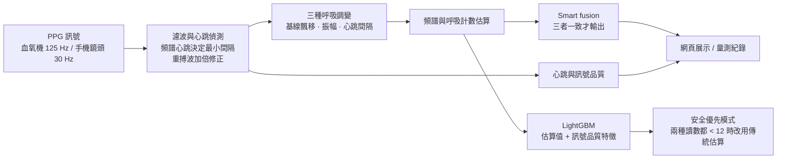
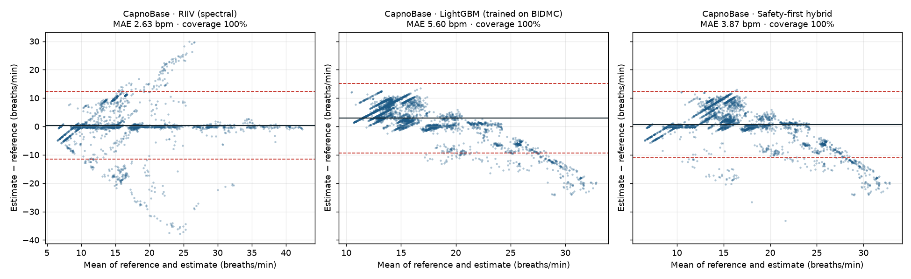

# PPG 呼吸速率估算

[](https://github.com/Joshhsu921/ppg-respiratory-rate/actions/workflows/tests.yml)

從光體積變化描記訊號(PPG,也就是血氧機與智慧手錶上的光學脈搏訊號)估算呼吸速率,比較傳統訊號處理和機器學習兩類方法,並提供一個可以用手機鏡頭即時量測的網頁展示。

**重點摘要**

- **呼吸速率:** 在 BIDMC(53 位 ICU 病人)依病人分組交叉驗證,LightGBM MAE **1.95 次/分**,優於傳統方法。**但在外部資料集 CapnoBase(42 位手術麻醉中的兒童與成人)排名完全反轉:** LightGBM MAE 5.60 最差,傳統的 smart fusion MAE **1.00** 最好,抓呼吸過慢與過快的敏感度都是 93%。LightGBM 學到的是 BIDMC 的呼吸速率分布,換了族群就失準;網頁因此採用 smart fusion。
- **VO2 max:** 用 955 次實測的跑步機最大攝氧量測試驗證。只靠年齡、性別、BMI 的誤差約 ±12.5%,95% 界限 ±14 mL/kg/min;Uth 心跳公式因資料中沒有真正的靜止心跳而無法正確驗證。網頁只以**實驗性卡片**呈現,完整顯示誤差範圍,並對照 FRIEND 常模。
- **心跳:** 以心電圖為參考,實際上線的網頁演算法在血氧機訊號(降到 30 Hz)上 MAE **1.75 次/分**(商用監視器 0.99)。**但在 50 位一般成人的手機錄影(BUT PPG)上,指尖靜止時 MAE 16.6 次/分,只有 37% 在 ±5 次以內**;專家判定訊號良好時 MAE 5.4。手機鏡頭量心跳的準確度目前不足。
- **網頁:** 定位為一般成人的居家健康參考(原型):手機鏡頭即時量測、量測紀錄與情境統計、實驗性 VO2 max、資料集重播,並在頁面上列出每項數值的驗證狀態。紀錄只存在裝置上。
- **限制:** 呼吸速率只在臨床病人和醫療級血氧機上驗證過,**一般成人、手機鏡頭都還沒有呼吸速率的驗證資料**。



**線上展示:** <https://joshhsu921.github.io/ppg-respiratory-rate/>(手機開啟可用鏡頭量測)


QR Code 由 `python scripts/make_qr.py` 產生;網址改變時重新執行即可。

> 作品集技術展示,未經臨床驗證,不可用於診斷或病人監測。

## 預期用途

| 項目 | 範圍 |
|---|---|
| **目標族群** | 18 歲以上一般成人 |
| **使用情境** | 在家、安靜不動時,用手機鏡頭量測呼吸速率與心跳,做為個人健康參考與長期追蹤 |
| **定位** | 作品集原型,不是醫療器材,不可用於診斷、監測或治療決策 |
| **不適用** | 兒童、心律不整(例如心房顫動、頻繁的期外收縮)、運動中或運動後立即量測、末梢循環不良 |

### 驗證證據和目標族群的差距

各項數值是在不同族群、不同設備上驗證的,沒有一項完全等於「在家用手機的一般成人」:

| 數值 | 驗證族群與設備 | 結果 | 和目標的差距 |
|---|---|---|---|
| 呼吸速率 | ICU 病人(BIDMC)、手術麻醉中病人(CapnoBase);醫療級血氧機 | 外部 MAE 1.00,成人 95% 界限 −2.8 ~ +2.1 | **族群與設備都不同**,沒有一般成人或手機的驗證 |
| 心跳(血氧機) | ICU 病人;醫療級血氧機 | MAE 1.75 | 族群不同 |
| 心跳(手機鏡頭) | **一般成人 50 位;手機指尖錄影(BUT PPG)** | 指尖靜止 MAE 16.6,37% 在 ±5 以內 | **族群與設備相符,但準確度不足** |
| VO2 max | 業餘與職業運動員;跑步機實測 | 95% 界限 ±14 mL/kg/min | 族群不同(運動員),且沒有真正的靜止心跳 |
| 體能等級 | FRIEND 美國一般成人 | 正式發表的常模 | 估算值本身誤差大 |

網頁上有同樣的「驗證狀態」表格,讓使用者看到每項數值的證據程度。

### 補齊差距所需的驗證

1. **手機鏡頭心跳:** 改善後,以 BUT PPG **依受試者分成開發組和測試組**重新評估,避免拿測試資料調整演算法;再用 32 秒的錄影驗證,和網頁實際的視窗長度一致。
2. **一般成人的呼吸速率:** 需要健康成人、自然呼吸、同時有手機 PPG 與參考呼吸訊號(例如胸帶或二氧化碳監測)的資料。目前沒有找到合適的公開資料,需要自行收案,建議至少 30 人,涵蓋不同膚色、年齡與性別,並在安靜時量測。
3. **VO2 max:** 需要一般成人(不是只有運動員)同時有真正的靜止心跳與實測 VO2 max 的資料。

**限定成人的理由:**

- **驗證資料以成人為主。** BIDMC 的 53 位病人全是成人;CapnoBase 外部驗證中,smart fusion 在成人的 95% 一致性界限是 −2.8 ~ +2.1 次/分,兒童是 −7.3 ~ +6.4,約為成人的 3 倍。
- **演算法有成人的假設:** 只搜尋每分鐘 4–42 次的呼吸(嬰幼兒正常可達 30–60 次)、心跳上限每分鐘 180 下。
- **VO2 max 常模(FRIEND)只涵蓋 20–79 歲**,估算模型的訓練資料也以成人運動員為主。

**限定成人不代表成人已經驗證完成:** 見上方的差距表。

網頁頁首會顯示適用範圍;基本資料的年齡低於 18 歲時,不計算 VO2 max。

## 為什麼做這個

呼吸速率是預警病情惡化最敏感的生命徵象之一(NEWS 等早期預警評分都包含它),但在病房裡最常被目測估算,甚至漏量。血氧機本來就有 PPG 訊號,如果能從同一個訊號估算呼吸速率,就不需要額外的感測器。

## 方法

呼吸會在 PPG 上留下三種調變(Karlen et al., 2013):

| 調變 | 生理機制 | 程式中的名稱 |
|---|---|---|
| 基線飄移 | 胸腔壓力改變靜脈回流 | `riiv` |
| 脈搏振幅變化 | 每搏輸出量隨呼吸改變 | `riav` |
| 心跳間隔變化 | 呼吸性竇性心律不整 | `rifv` |

處理流程(`src/ppgrr/dsp.py`):

1. PPG 濾波(0.5–8 Hz)後偵測每一下心跳的波峰和波谷。
2. 每下心跳取一個值,形成三條逐拍序列,重新取樣到 4 Hz。
3. 在呼吸頻帶(每分鐘 4–42 次)內用頻譜峰值和呼吸計數兩種方式估算呼吸速率。
4. **Smart fusion:** 三種估算的標準差 ≤ 4 次/分時才輸出平均值,否則判定為訊號不可靠並拒絕輸出。
5. **LightGBM:** 以上述估算值和訊號品質特徵(心跳數、心跳間隔變異、PPG 偏度與峰度、頻譜集中度)作為輸入,學習修正誤差。

## 資料

[BIDMC PPG and Respiration Dataset](https://physionet.org/content/bidmc/1.0.0/)(PhysioNet,ODC-BY 1.0):53 位 ICU 病人,每位 8 分鐘,PPG 取樣率 125 Hz。參考呼吸速率由兩位標註者在阻抗呼吸訊號上逐次標註呼吸。

- 視窗:32 秒,每 4 秒滑動一次。
- 參考值:視窗內呼吸間隔平均值換算的呼吸速率(兩位標註者取平均)。
- **依病人分組的 5 折交叉驗證:** 每位病人的預測都來自沒看過這位病人的模型,避免同一病人的視窗同時出現在訓練和測試資料中。

## 結果

### 呼吸速率

53 位病人、5,986 個視窗,依病人分組 5 折交叉驗證(`results/metrics.csv`):

| 方法 | 涵蓋率 | MAE(次/分) | 偏差 | 95% 一致性界限 | 誤差 ≤ 2 次/分 |
|---|---|---|---|---|---|
| 基線飄移(頻譜) | 100% | 3.24 | −2.53 | −12.1 ~ +7.0 | 65% |
| 脈搏振幅(頻譜) | 100% | 5.84 | −4.28 | −16.9 ~ +8.3 | 37% |
| 心跳間隔(頻譜) | 100% | 5.67 | −1.25 | −16.3 ~ +13.8 | 40% |
| Smart fusion(頻譜) | 54% | 3.49 | −2.72 | −11.4 ~ +5.9 | 49% |
| Smart fusion(呼吸計數) | 83% | 2.95 | −1.93 | −8.2 ~ +4.4 | 43% |
| **LightGBM** | 100% | **1.95** | +0.14 | −5.7 ~ +6.0 | **68%** |
| LightGBM(僅 fusion 接受的視窗) | 54% | 2.04 | +0.35 | −5.8 ~ +6.5 | 66% |
| 兩位標註者之間(上限參考) | 100% | 0.38 | +0.16 | −2.0 ~ +2.4 | 93% |


**重要發現:LightGBM 會往平均值靠攏。** 79% 的視窗呼吸速率落在每分鐘 12–20 次,模型在這個範圍表現最好,但在**呼吸過慢**時反而遠比簡單的訊號處理方法差(`results/mae_by_rr_band.csv`):

| 參考呼吸速率 | 基線飄移 MAE | LightGBM MAE | 視窗數 |
|---|---|---|---|
| < 12 次/分 | **1.34** | 8.86 | 273 |
| 12–20 次/分 | 3.03 | **1.38** | 4,723 |
| > 20 次/分 | 4.73 | **2.76** | 990 |

呼吸過慢是臨床上要抓的警訊之一,例如術後鴉片類止痛藥造成的呼吸抑制;NEWS2 預警評分中,每分鐘 ≤ 8 次就是最高的 3 分。整體平均誤差最低的模型,可能在這種時候把數字往正常範圍拉,反而延誤警示。

#### 嘗試改善呼吸過慢(`scripts/slow_breathing.py`,`results/slow_breathing.csv`)

除了 MAE,也計算每種方法**判斷「呼吸過慢」(< 12)的敏感度和特異度**,因為臨床上要的是「該警示時有警示」:

| 方法 | 整體 MAE | 過慢時 MAE | 過慢敏感度 | 過慢特異度 |
|---|---|---|---|---|
| 基線飄移(傳統) | 3.23 | 1.34 | 92% | 74% |
| LightGBM | **1.95** | 8.86 | **0%** | 99% |
| LightGBM + 依出現頻率反向加權 | 2.10 | 9.01 | 0% | 98% |
| 混合:基線飄移 < 12 就採用它 | 3.48 | 1.35 | 92% | 74% |
| **安全優先:基線飄移的頻譜法和計數法都 < 12 才採用** | 2.33 | **2.23** | **77%** | **90%** |

- **加權訓練沒有用。** 呼吸過慢的視窗只來自 11 位病人,交叉驗證時,被測試病人的過慢模式在訓練資料中幾乎沒有,模型學不起來。
- **模型對自己太有自信。** LightGBM 分位數迴歸的 80% 預測區間,實際只涵蓋 54% 的真實值,呼吸過慢時是 0%,所以「區間太寬就不輸出」的策略篩不掉錯的視窗。
- **單一方法的混合誤報太多:** 基線飄移本身平均低估 2.5 次/分,很多正常呼吸被讀成 < 12。要求兩種讀數都同意才切換,特異度從 74% 提高到 90%。
- **要用哪一種,取決於應用情境:** 一般監測可用 LightGBM(準確度優先);術後呼吸抑制監測這類情境,應選安全優先模式。
- **注意:** 安全優先的規則是在同一份資料上比較 5 種規則後選出的,結果可能偏樂觀,需要在獨立資料集上確認。
- 所有方法抓呼吸過快(> 20)的能力都不好(LightGBM 敏感度 20%,基線飄移 52%),還需要改善。

### 心跳

以 BIDMC 監視器同步記錄的**心電圖心跳**為參考值,32 秒與 10 秒視窗(`scripts/validate_hr.py`,`results/hr_metrics.csv`)。「網頁演算法」是把 PPG 降到每秒 30 個樣本(和手機鏡頭相同),再用實際上線的 `web/ppg-dsp.js` 計算(`scripts/hr_web_eval.js`)。

| 視窗 | 方法 | MAE(次/分) | 偏差 | 95% 一致性界限 | 誤差 ≤ 5 次/分 |
|---|---|---|---|---|---|
| 32 秒 | 簡單波峰偵測(Python,125 Hz) | 2.49 | +1.45 | −21.3 ~ +24.2 | 96% |
| 32 秒 | **網頁演算法(30 Hz)** | **1.75** | −0.60 | −6.9 ~ +5.7 | 96% |
| 32 秒 | 監視器內建脈搏(商用演算法,對照) | 0.99 | −0.72 | −5.5 ~ +4.1 | 97% |
| 10 秒 | **網頁演算法(30 Hz)** | 2.51 | −0.99 | −12.8 ~ +10.9 | 91% |
| 10 秒 | 監視器內建脈搏(商用演算法,對照) | 1.36 | −0.73 | −6.8 ~ +5.4 | 95% |


- 網頁演算法用頻譜心跳決定兩次心跳的最小間隔,一致性界限比簡單波峰偵測窄很多(±6 vs ±23),因為它不會把重搏切跡誤認成心跳。
- **訊號品質標示有用:** 32 秒視窗中,「良好」的 MAE 是 1.44,「不穩定」是 4.78。
- **心電心跳和脈搏不一致(41 號病人):** 誤差最大的病人。部分時段心電心跳在每分鐘 53–85 次之間跳動,網頁演算法和**監視器內建的商用演算法都是 50**。PPG 波形上每次脈搏之後的小波峰位在週期 33% 處,是重搏波而不是被漏掉的弱心跳。最可能是**脈搏短絀**:部分心跳(例如期外收縮)沒有產生可量到的脈搏。PPG 只看得到有效的脈搏,單靠 PPG 無法偵測這種情況,這是 PPG 量心跳的本質限制,也代表品質標示「良好」**無法保證數值和心電圖一致**。
- **重搏波過強時心跳加倍(已修正):** 合成訊號測試發現,重搏波很明顯時,頻譜會抓到兩倍的頻率,心跳被算成兩倍。現在會檢查被算成心跳的波峰是否一高一低或一短一長交替:間隔一短一長就判定為重搏波,改用一半的頻率重新偵測;高低交替但間隔平均(可能是真正的弱心跳)則不硬選,頁面同時顯示兩個可能的心跳並把品質降為「尚可」。這項判斷需要至少 16 下心跳,因為在 10 秒視窗上,一半以上的標示是誤報。修正後 BIDMC 整體結果不變(32 秒 MAE 1.74 → 1.75),合成情境測試見 `tests/web_dsp_cases.js`。
- 只有 10 秒的視窗誤差明顯變大,運動後心跳恢復模式若要用短視窗,需要先改善並另外驗證。
- 這是醫療級血氧機的訊號降取樣後的結果,**不等於手機鏡頭的準確度**,手機鏡頭的結果見下一節。

### 心跳:手機鏡頭(BUT PPG)

[BUT PPG](https://physionet.org/content/butppg/2.0.0/)(Brno University of Technology,PhysioNet,CC BY 4.0):50 位成人(19–76 歲,男女各半)用兩款手機錄製的 3,888 段 10 秒 PPG,30 Hz,同步記錄心電圖。指尖貼後鏡頭或耳朵貼前鏡頭,並有靜止、加壓、滑動、走路、咳嗽、笑、改變光線、說話等情境。參考心跳是心電圖 10 秒內的中位數;每段另有專家品質標註:3 或 5 位專家只看 PPG 估心跳,多數人誤差 ≤ 5 次/分才算「良好」。

把**實際上線的網頁演算法**原封不動地跑在這些錄影上,和網頁一樣在紅色與綠色通道中選訊號較好的一個(`scripts/butppg_export.py` → `scripts/butppg_eval.js` → `scripts/validate_butppg.py`,`results/butppg_metrics.csv`):

| 情境 | 紀錄 / 受試者 | MAE | 偏差 | 95% 一致性界限 | 誤差 ≤ 5 次/分 |
|---|---|---|---|---|---|
| **指尖、靜止(網頁的使用方式)** | 1,354 / 30 | **16.6** | −13.8 | −52.3 ~ +24.8 | **37%** |
| 指尖、靜止、專家判定良好 | 477 / 30 | 5.4 | −3.3 | −23.8 ~ +17.1 | 78% |
| 指尖、靜止、專家判定不佳 | 877 / 20 | 22.8 | −19.5 | −60.9 ~ +22.0 | 14% |
| 指尖、靜止、網頁判定品質「良好」 | 382 / 30 | 8.8 | −6.5 | −36.7 ~ +23.7 | 66% |
| 耳朵、靜止 | 1,370 / 20 | 18.9 | −15.0 | −52.5 ~ +22.5 | 25% |
| 指尖、走路 / 咳嗽 / 笑 | 各 70 / 18 | 24.8–27.4 | −23.6 ~ −26.1 | — | 23–30% |


- **手機鏡頭量心跳的準確度不足。** 指尖靜止時只有 37% 在 ±5 次以內,而且系統性低估,代表常常漏算心跳。
- **主要原因是訊號品質:** 專家只判定 35% 的指尖靜止錄影「看得出準確的心跳」。訊號良好時,MAE 降到 5.4。
- **視窗太短也是原因之一:** 每段只有 10 秒,網頁實際用 32 秒;在 BIDMC 上,10 秒視窗的 MAE 本來就比 32 秒大(2.5 vs 1.75)。
- **網頁的品質判斷只有部分有效:** 判為「良好」的紀錄中,66% 是專家判定的好訊號;專家判定的好訊號,也只有 53% 被網頁判為「良好」(`results/butppg_quality_crosstab.csv`)。
- **訊號方向不是問題:** 這份資料有兩種儲存格式,方向相反。方向是用波形特徵(血量波形上升快、下降慢)判斷的,不是用準確度挑選;把方向反過來重跑,結果幾乎一樣(MAE 16.5)。
- **沒有用這份資料調整演算法。** 若要改進,應依受試者分成開發組與測試組,避免高估效果。

### 外部驗證:CapnoBase

[CapnoBase IEEE TBME Respiratory Rate Benchmark](https://doi.org/10.5683/SP2/NLB8IT)(Karlen et al., 2013):42 筆手術麻醉中的 8 分鐘紀錄,28 位兒童、13 位成人、1 位年齡不詳,23 筆自主呼吸、19 筆呼吸器控制通氣,PPG 取樣率 300 Hz。參考值是**二氧化碳波形上每次吐氣開始的時間**。視窗設定和 BIDMC 相同,並排除標註為 PPG 雜訊的視窗,共 4,341 個。

**沒有在 CapnoBase 上做任何調整**(原作者也要求這份資料只用來測試):LightGBM 用全部 BIDMC 視窗重新訓練、參數不變,安全優先規則的門檻也不變(`scripts/external_capnobase.py`,`results/capnobase_metrics.csv`)。

| 方法 | BIDMC MAE(內部) | **CapnoBase MAE(外部)** | 涵蓋率 | 抓到過慢(< 12) | 抓到過快(> 20) |
|---|---|---|---|---|---|
| 基線飄移(頻譜) | 3.24 | 2.63 | 100% | 77% | 80% |
| **Smart fusion(頻譜)** | 3.49 | **1.00** | 73% | **93%** | **93%** |
| Smart fusion(呼吸計數) | 2.95 | 2.05 | 91% | 61% | 80% |
| LightGBM(BIDMC 訓練) | **1.95** | 5.60 | 100% | 1% | 79% |
| 安全優先混合 | 2.33 | 3.87 | 100% | 58% | 79% |



- **內部驗證最好的模型,外部驗證最差。** CapnoBase 的呼吸速率分布和 BIDMC 很不一樣:中位數每分鐘 11.8 次,54% 的視窗低於 12 次,兒童最快到 43 次。LightGBM 把預測往 BIDMC 的範圍拉,平均高估 2.9 次/分。
- **不靠訓練資料的 smart fusion 最穩定:** 三種調變一致才輸出,放棄了 27% 的視窗,換來輸出時的 MAE 1.00、95% 界限 −6.2 ~ +5.3。
- **安全優先規則在外部沒有維持效果:** 抓到過慢的比例從 BIDMC 的 77% 降到 58%,代表那條規則確實有些針對 BIDMC。
- **成人和兒童差很多:** smart fusion 在成人的 MAE 是 0.72,95% 界限 −2.8 ~ +2.1;兒童是 1.13,界限 −7.3 ~ +6.4。
- 呼吸器控制通氣的 19 筆中,沒有呼吸過快的視窗,該組的過快敏感度沒有意義。
- **結論:** 這份資料不足以讓機器學習模型推廣到不同族群。網頁採用 smart fusion,這個選擇現在有外部證據支持。若要讓模型推廣,訓練資料需要涵蓋更廣的呼吸速率與族群。

### VO2 max:驗證結果與實驗性卡片

想法是用年齡、性別、身高體重,加上手機量到的靜止心跳,估算最大攝氧量。用 [Treadmill Maximal Exercise Tests(University of Malaga,PhysioNet)](https://physionet.org/content/treadmill-exercise-cardioresp/1.0.1/) 的實測值驗證:955 次測試、824 人(多為業餘與職業運動員,女性 15%),實測 VO2 max 為 47.0 ± 8.8 mL/kg/min。依「人」分組交叉驗證(`scripts/vo2max.py`,`results/vo2max_metrics.csv`)。

| 方法 | MAE(mL/kg/min) | 誤差百分比 | 95% 一致性界限 | 相關係數 |
|---|---|---|---|---|
| Uth 公式:15.3 × (208 − 0.7 × 年齡) ÷ 開始時心跳 | 14.8 | 30% | −35.9 ~ +10.2 | 0.09 |
| 線性迴歸:年齡、性別、BMI | **5.6** | **12.5%** | −14.1 ~ +14.1 | 0.58 |
| 線性迴歸:再加開始時心跳 | 5.6 | 12.5% | −14.1 ~ +14.1 | 0.58 |
| LightGBM:年齡、性別、BMI、開始時心跳 | 5.7 | 12.9% | −14.4 ~ +14.5 | 0.55 |
| 只猜平均值(對照) | 7.0 | 16.1% | −17.3 ~ +17.3 | — |

- **資料中沒有真正的靜止心跳。** 只有測試開始時(站立或開始走路)的心跳,中位數 89,遠高於運動員的靜止心跳。所以 Uth 公式嚴重低估,這份資料**無法正確驗證**它。只看從靜止站立開始的 193 次測試,MAE 仍有 11.5。
- **加入心跳完全沒有改善**,加上模擬的手機心跳誤差(依 BIDMC 的心跳驗證結果)也沒有影響,原因同上。
- **只靠基本資料,** 95% 界限是 ±14 mL/kg/min。真實值 45 的人可能被估成 31 或 59,對個人來說太不精確。
- **結論:** 目前沒有證據顯示手機量的心跳能改善估算,只靠基本資料又太不精確,所以不當成正式功能。若要正式評估,需要同時有靜止心跳和實測 VO2 max 的資料,而且受試者不能只有運動員。

**網頁上的實驗性卡片**(`web/vo2.js`)把這些不確定性直接呈現出來,而不是隱藏:

- 只在有基本資料(年齡、性別、身高、體重,只存在裝置上),而且有一筆「休息 + 坐著或躺著」的量測時,才用該筆心跳當作靜止心跳。
- **兩種估算並列:** 基本資料模型(上表的線性迴歸,係數由 `scripts/vo2max.py` 匯出到 `web/data/vo2max_model.json`),顯示交叉驗證得到的 95% 範圍;以及 Uth 心跳比值公式,標示「本專案無法驗證誤差」,不顯示範圍。
- **等級對照:** 使用 FRIEND 資料庫的跑步機實測常模(Kaminsky et al., *Mayo Clin Proc* 2015,Table 2:20–79 歲、男女分開的第 5 到 95 百分位),分成偏低(< P25)、中下、中上、良好(P75–90)、優秀(≥ P90)。卡片會標出範圍橫跨幾個等級,通常是 4–5 個。
- **主動提醒:** 年齡 40 歲以上時,提醒模型以運動員訓練、年齡影響被低估,估算值可能偏高;選「不透露」性別時,只顯示不需要性別的心跳比值公式。
- **靜止心跳趨勢:** 列出最近的休息時心跳變化,這比單次 VO2 max 數字更有參考價值。

### 修正紀錄

- **2026-11-06:取樣率錯誤。** BIDMC CSV 的時間欄位經過四捨五入,舊版用時間差的中位數推算取樣率,得到 100 Hz(正確是 125 Hz)。參考值和估算值被同樣縮放成 0.8 倍,所以結果看似合理,實際上數字和濾波頻帶都不正確。修正後重新計算,上方都是修正後的結果;舊版「LightGBM 在呼吸過快時最差」的結論不成立,改為「呼吸過慢時最差」。已加入單元測試防止再次發生。網頁演算法直接使用時間戳,不受影響。

## 網頁展示功能

- **手機鏡頭即時量測:** 指尖蓋住鏡頭約 40 秒,顯示呼吸速率、心跳、訊號品質,以及三種調變各自的估算值。程式會自動在紅色和綠色通道中選訊號較好的一個(紅色在強光下容易過曝)。
- **量測紀錄:** 儲存每次量測,並記下情境(休息、起床後、睡前、運動後、工作、壓力、身體不適)、姿勢和備註。
  - **自己數一次:** 內建 30 秒計時器,和 App 的估算比較,累積後顯示平均差距,等於一個小型的個人驗證。
  - **趨勢圖與情境統計:** 依情境分色,並標出休息時常見範圍(每分鐘 12–20 次)。
  - **匯出 CSV**,可以拿回 Python 分析。
  - 紀錄只存在裝置的瀏覽器(localStorage),不會上傳。
- **VO2 max 估計(實驗性):** 兩種估算、95% 範圍、FRIEND 同年齡同性別常模,以及靜止心跳趨勢(說明見上方「VO2 max」)。
- **資料集重播:** BIDMC 病人紀錄的參考值、訊號處理和 LightGBM 估算比較。

## 專案結構

```
src/ppgrr/      dsp.py(訊號處理)、data.py(資料載入)、features.py、evaluate.py
scripts/        prepare_data.py → run_experiments.py → export_demo.py;心跳驗證:hr_web_eval.js → validate_hr.py
tests/          合成訊號的單元測試(pytest);web_dsp_cases.js 測網頁演算法(node)
web/            純前端網頁:index.html、ppg-dsp.js(dsp.py 的 JavaScript 版本)、log.js(量測紀錄)、vo2.js(VO2 max 卡片)
```

## 重現步驟

```bash
python -m venv .venv
.venv\Scripts\activate
pip install -e ".[dev]"
pytest
# 下載 https://physionet.org/content/bidmc/get-zip/1.0.0/ 並解壓縮到 data/raw/
python scripts/prepare_data.py
python scripts/run_experiments.py
python scripts/slow_breathing.py   # 呼吸過慢的改善實驗
python scripts/download_capnobase.py && python scripts/external_capnobase.py   # 外部驗證(下載即同意 CapnoBase 使用協議)
# 下載 https://physionet.org/content/treadmill-exercise-cardioresp/get-zip/1.0.1/ 解壓縮到 data/raw/treadmill/
python scripts/vo2max.py
# 下載 https://physionet.org/content/butppg/get-zip/2.0.0/ 解壓縮到 data/raw/butppg/
python scripts/butppg_export.py && node scripts/butppg_eval.js && python scripts/validate_butppg.py   # 手機心跳驗證
python scripts/export_demo.py
node scripts/hr_web_eval.js && python scripts/validate_hr.py   # 心跳驗證
python -m http.server 8000 -d web   # 開啟 http://localhost:8000
```

## 限制

- 資料只有 53 位病人,來自單一醫院的 ICU,而且都是靜止狀態;沒有測試走動或運動時的表現。
- 參考值來自阻抗呼吸訊號的人工標註,本身也有誤差(見結果中兩位標註者之間的一致性)。
- 外部驗證只有 CapnoBase 一份資料(42 筆、手術麻醉中),還不能代表一般人在家使用的情境。
- 手機鏡頭量測的訊號品質比醫療級血氧機差,網頁展示只用來說明原理。

## 參考文獻

- Karlen W, et al. Multiparameter respiratory rate estimation from the photoplethysmogram. *IEEE Trans Biomed Eng* 2013;60:1946–53.
- Pimentel MAF, et al. Toward a robust estimation of respiratory rate from pulse oximeters. *IEEE Trans Biomed Eng* 2017;64:1914–23.
- Charlton PH, et al. Breathing rate estimation from the electrocardiogram and photoplethysmogram: a review. *IEEE Rev Biomed Eng* 2018;11:2–20.
- Schäfer A, Kratky KW. Estimation of breathing rate from respiratory sinus arrhythmia. *Ann Biomed Eng* 2008;36:476–85.
- Karlen W, Turner M, Cooke E, Dumont GA, Ansermino JM. CapnoBase: signal database and tools to collect, share and annotate respiratory signals. Annual Meeting of the Society for Technology in Anesthesia, 2010.
- Mongin D, García Romero J, Alvero Cruz JR. Treadmill Maximal Exercise Tests from the Exercise Physiology and Human Performance Lab of the University of Malaga (version 1.0.1). PhysioNet, 2021.
- Kaminsky LA, Arena R, Myers J. Reference standards for cardiorespiratory fitness measured with cardiopulmonary exercise testing: data from the Fitness Registry and the Importance of Exercise National Database. *Mayo Clin Proc* 2015;90:1515–23.
- Uth N, et al. Estimation of VO2max from the ratio between HRmax and HRrest – the Heart Rate Ratio Method. *Eur J Appl Physiol* 2004;91:111–5.
- Tanaka H, Monahan KD, Seals DR. Age-predicted maximal heart rate revisited. *J Am Coll Cardiol* 2001;37:153–6.
- Nemcova A, et al. Brno University of Technology Smartphone PPG Database (BUT PPG) (version 2.0.0). PhysioNet, 2024.
- Goldberger AL, et al. PhysioBank, PhysioToolkit, and PhysioNet. *Circulation* 2000;101:e215–20.
